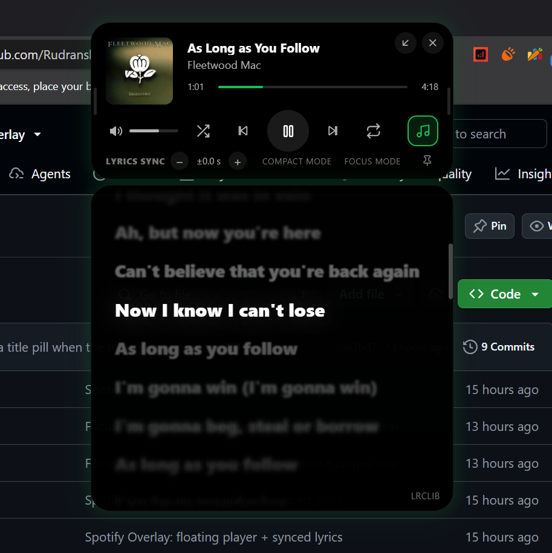
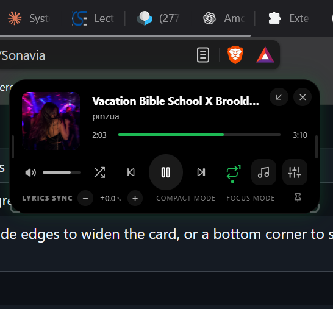
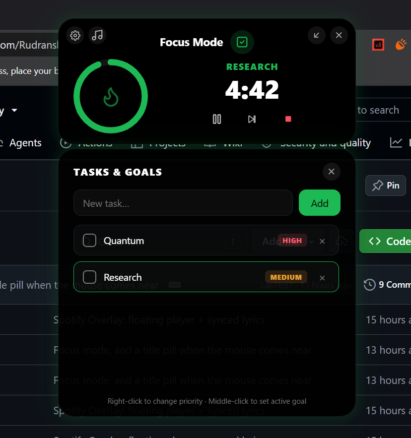
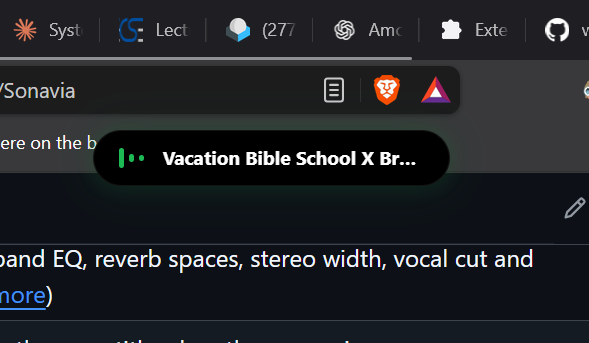

<div align="center">


# Sonavia

**Your Spotify, on stage: a floating player with live synced lyrics and a full DJ deck, in every tab, a popup window, or on top of any app.**
Speed, pitch, EQ, reverb and more. No API key. No Premium. No login.

[](#-installation)
[](manifest.json)
[](manifest.json)
[](LICENSE)

<br/>



<br/><br/>

[**⬇️ Download**](https://github.com/RudranshVerma23/Sonavia/releases/latest) &nbsp;·&nbsp; [**🚀 Install**](#-installation) &nbsp;·&nbsp; [**🎛️ DJ deck**](#%EF%B8%8F-the-dj-deck) &nbsp;·&nbsp; [**🎮 Usage**](#-usage)

</div>

---

## ✨ What It Does

Sonavia adds a button to the Spotify Web Player (`open.spotify.com`, or Spotify installed as a web app). It opens a compact player with synced lyrics and a DJ deck that reshapes the music as it plays. You can show it in three places:

| Mode | Where it shows | Needs |
|---|---|---|
| **In-browser** | On top of every browser tab | Extension |
| **Popup** | Always-on-top Picture-in-Picture window | Extension |
| **Desktop** | Transparent overlay above every app; clicks pass through around it | Extension + desktop add-on (Windows) |

---

## 🎯 Features

| Feature | Details |
|---|---|
| 🎵 Playback | Play/pause, previous/next, shuffle, repeat, seek, volume and mute |
| 🎤 Synced lyrics | Auto-scrolling panel, click a line to seek, per-song timing offset; stays in sync at any speed |
| 🎛️ DJ deck | Speed, pitch, vinyl mode, 10-band EQ, reverb spaces, stereo width, vocal cut and boost, with one-tap presets ([more](#%EF%B8%8F-the-dj-deck)) |
| 🫧 Auto-collapse | Shrinks to a small circle; shows the song title when the mouse is near |
| ⏱️ Focus mode | Focus/break timer with a progress ring, chime, and a Tasks & Goals list |
| 📐 Compact mode & resize | Slim one-line strip; drag the side edges to widen the card, or a bottom corner to scale the whole overlay |
| 📌 Pin | Keep it expanded |
| 🔒 Private | No account, no analytics; lyrics come from [LRCLIB](https://lrclib.net) |

<p align="center">
  
  
  
</p>

---

## 🎛️ The DJ Deck

Click the **sliders button** (next to ♫) and the deck drops down under the player, like the lyrics panel. It moves with the overlay and works in every mode, including the popup window and the desktop overlay.

| Control | What it does |
|---|---|
| **Presets** | Normal, Slowed + reverb, Nightcore, Bass boost, Lo-fi, Concert, Vaporwave, Karaoke, Wide, Cathedral |
| **Speed** | 0.5×–2× |
| **Vinyl** | On: speed also bends the pitch, like a record (nightcore / slowed). Off: speed changes only the tempo |
| **Pitch** | ±12 semitones without changing speed. Shows the pitch you actually hear; a dotted arc is the part vinyl speed adds |
| **Reverb + Space** | How much echo, and which room: Room, Studio, Plate, Concert hall, Church, Cathedral, Cave, Space |
| **Width** | Mono to extra-wide stereo |
| **Vocals** | Cuts centred vocals for karaoke |
| **Boost** | Extra gain on top of Spotify's volume, with a limiter so it doesn't clip |
| **Equalizer** | 10 bands (31 Hz–16 kHz) with 15 presets |

Knobs: drag up/down (hold Shift for fine control), scroll, or use the arrow keys. Double-click any knob or slider to reset it. Volume stays on Spotify's own volume bar.

**Light on your computer.** The deck runs on the browser's built-in audio processing, not JavaScript, and each effect is only switched on while it's in use. Music stays clean even when the Spotify tab is in the background.

---

## 🚀 Installation

**Requirements:** Brave, Chrome, Edge or Chromium 116+. The desktop add-on also needs Windows 10/11.

### 1. Extension

1. Download [**Sonavia-extension.zip**](https://github.com/RudranshVerma23/Sonavia/releases/latest/download/Sonavia-extension.zip) and unzip it into a folder you'll keep (or `git clone https://github.com/RudranshVerma23/Sonavia.git`).
2. Open `brave://extensions` (or `chrome://extensions`) and turn on **Developer mode**.
3. Click **Load unpacked** and select that folder.
4. Refresh any open tabs.

### 2. Desktop add-on *(optional)*

A ~3 MB app that starts only when you choose the desktop overlay, and quits when it closes. It never runs at startup.

1. Download [**Sonavia-desktop.zip**](https://github.com/RudranshVerma23/Sonavia/releases/latest/download/Sonavia-desktop.zip) and unzip it into a folder you'll keep.
2. Run `install.cmd` (per-user, no admin). Run it again if you move the folder.
3. **Fully exit the browser once** (menu → **Exit**) and reopen it.

<details>
<summary>Build the add-on from source instead</summary>

1. Install Rust from [rustup.rs](https://rustup.rs), with either the MSVC toolchain (plus Visual Studio Build Tools, "Desktop development with C++") or the GNU toolchain with MSYS2 `gcc`.
2. Run `desktop\build.cmd`, then `desktop\install.cmd`.

</details>

To remove it, run `uninstall.cmd` and delete the folder.

---

## 🎮 Usage

Play something on Spotify, then click the **overlay button** in the player bar (left of the Lyrics button) or the extension's toolbar icon. It never opens by itself.

| Control | Action |
|---|---|
| **↗** / **🖥** / **↙** | Move to the popup window / desktop overlay / back into the browser |
| **♫** | Lyrics panel. Scroll to pause autoscroll; click a line to seek |
| **Sliders** | DJ deck (see [The DJ Deck](#%EF%B8%8F-the-dj-deck)) |
| **LYRICS SYNC − / +** | Shift this song's lyrics by 0.5 s |
| **COMPACT MODE** | One-line strip; exit with ⤢ |
| **FOCUS MODE** | Timer view. ⚙ sets lengths and chime, ☑ opens Tasks & Goals |
| **📌** | Keep expanded |
| Card side edges | Drag to make it wider or narrower |
| Bottom corners | Drag outward / inward to make the whole overlay bigger / smaller (70–160%); double-click to reset |
| Empty space | Drag to move (position is remembered) |

**Focus mode:** ⏭ during focus asks *Continue session?*; answering no (or waiting 5 s) starts the break. In Tasks & Goals, right-click a task to change its priority and middle-click to make it the active goal. Keep the Spotify tab open, since it runs the timer.

---

## 🔧 Troubleshooting

| Problem | Fix |
|---|---|
| Overlay missing on a tab | Refresh the tab |
| "Desktop add-on isn't set up" | Run `install.cmd` |
| "Error when communicating with the native messaging host" | Fully exit the browser and reopen it |
| Windows blocks `Sonavia.exe` | Turn off *Smart App Control* (the exe is unsigned) |
| Missing or wrong lyrics | Hover the lyrics panel and use **Retry** or **Wrong lyrics?** |
| Deck says **CLICK SPOTIFY ONCE** | The browser only starts audio effects after a click on the Spotify tab |
| Deck says **REFRESH SPOTIFY** | The Spotify tab was open before Sonavia was installed or updated |
| Effects don't apply | Turn off other Spotify audio extensions (e.g. Chorus); two can't process the same audio |
| Lyrics off after upgrading to 2.0 | Lyrics now follow the real audio at any speed; set **LYRICS SYNC** back to ±0.0 s on songs you'd adjusted |

**Updating:** unzip the new `Sonavia-extension.zip` over the old folder (or `git pull`), reload the extension and refresh tabs. For the add-on, download the new zip (or rebuild).

**Coming from Spotify Overlay (v1.4 or older)?** The project is now Sonavia. Reload the extension, then replace the desktop add-on with the new zip and run its `install.cmd` (it also removes the old registration). Fully exit the browser once and reopen it.

---

## 📦 Project Structure

```
Sonavia/
├── manifest.json
├── background/service-worker.js   ← lyrics lookup, relay to tabs and desktop
├── content/
│   ├── content.js                 ← Spotify tab: state, modes, focus timer
│   ├── audio-engine.js            ← DJ deck sound engine (runs in Spotify's page)
│   ├── spotify-dom.js             ← all Spotify selectors (edit when Spotify changes)
│   ├── overlay-view.js            ← overlay UI shared by every mode
│   └── mirror.js                  ← overlay on non-Spotify tabs
├── lib/                           ← LRCLIB search, line clock, storage
└── desktop/                       ← Tauri add-on (Rust + same overlay UI)
```

---

## 🙏 Credits

The idea of adding sound effects to the Spotify Web Player comes from [Chorus](https://github.com/chorus-studio/spotify) (MIT, © 2023 cdrani), and a few EQ curves and preset ideas started there. Sonavia's engine is its own: rebuilt on the browser's built-in audio processing so it stays light and clean in the background, made to follow every song so effects and volume hold across tracks, and turned into a DJ deck inside the overlay.

---

## 📄 License

[MIT](LICENSE) © 2026 Rudransh Verma. Not affiliated with or endorsed by Spotify.
